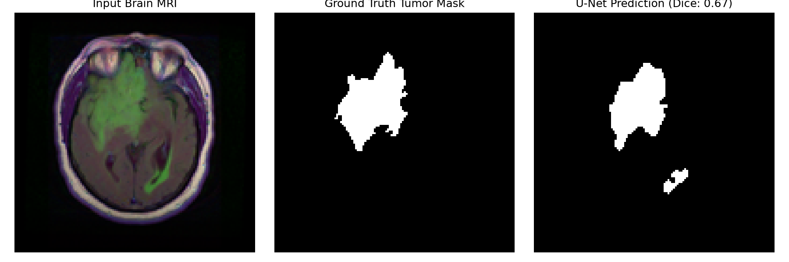
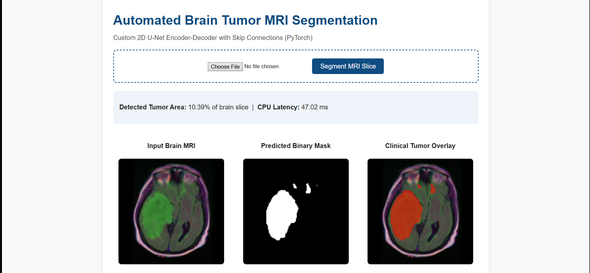

# Automated Brain Tumor MRI Segmentation with 2D U-Net

A PyTorch implementation of a custom **2D U-Net** encoder-decoder architecture with skip connections for pixel-level brain tumor segmentation on Lower-Grade Glioma (LGG) FLAIR MRI scans. Includes a Flask web interface that converts `.tif` medical slices into real-time binary masks and clinical overlays on standard CPU hardware.



## Interactive Flask Web Demo (CPU Inference)
The Flask web application (`app.py`) converts raw `.tif` MRI slices into browser-ready visualizations, computing the segmented tumor area percentage and rendering a red clinical overlay in real time on standard CPU hardware.




## Architecture & Clinical Methodology
- **Custom 2D U-Net:** Built from scratch in PyTorch with progressive downsampling (`32 → 64 → 128 → 256` channels) and symmetric skip connections to preserve fine spatial tumor boundaries.
- **Dataset:** [LGG MRI Segmentation Dataset](https://kaggle.com) (`3,929` multi-channel MRI slices paired with manual expert segmentation masks).
- **Loss Function (`BCE + Dice Loss`):** Combines Binary Cross-Entropy with soft Dice Loss to overcome severe foreground-background pixel imbalance.

## Quantitative Evaluation (Test Split)

| Segmentation Metric | Score | Clinical Meaning |
| :--- | :---: | :--- |
| **Mean Dice Similarity Coefficient** | **0.6899** | Strong spatial overlap across positive and negative slices |
| **Mean Intersection over Union (IoU)** | **0.6504** | Reliable tumor boundary delineation |

## Quickstart

1. **Clone the repository and install dependencies:**
   ```bash
   git clone https://github.com/abdoulrahmanebande/Automated-Brain-Tumor-Segmentation-on-MRI-Scans-using-U-Net/tree/main
   cd brain-tumor-mri-segmentation
   pip install -r requirements.txt
   ```

2. **Launch the Flask MRI segmentation web app:**
   ```bash
   python app.py
   ```
   Open `http://127.0.0.1:5000` in your browser and upload any `.tif` brain MRI slice to generate the predicted binary mask and clinical overlay.

